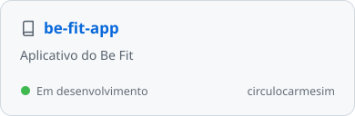
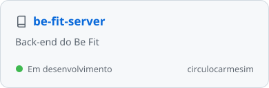

<picture>
  <source media="(prefers-color-scheme: dark)" srcset="assets/header-dark.svg">
  
</picture>

###  Sobre mim

- 💻 Desenvolvedor front-end na **[PBtec](https://github.com/PBtec)**
- 🎓 Estudante de Ciência da Computação na **FPB**
- 📍 João Pessoa, PB
- 🎨 Gosto de construir interfaces simples, rápidas e bem cuidadas
- 🌱 Sempre aprendendo algo novo

 

###  Stack

<picture>
  <source media="(prefers-color-scheme: dark)" srcset="assets/stack-dark.svg">
  
</picture>

 

###  Projetos

<a href="https://github.com/circulocarmesim/be-fit-app">
  <picture>
    <source media="(prefers-color-scheme: dark)" srcset="assets/card-be-fit-app-dark.svg">
    
  </picture>
</a>
<a href="https://github.com/circulocarmesim/be-fit-server">
  <picture>
    <source media="(prefers-color-scheme: dark)" srcset="assets/card-be-fit-server-dark.svg">
    
  </picture>
</a>

 

###  Contato

<a href="https://www.linkedin.com/in/SEU_USUARIO">
  <picture>
    <source media="(prefers-color-scheme: dark)" srcset="assets/btn-linkedin-dark.svg">
    
  </picture>
</a>
<a href="https://www.instagram.com/jheinrique_">
  <picture>
    <source media="(prefers-color-scheme: dark)" srcset="assets/btn-instagram-dark.svg">
    
  </picture>
</a>
